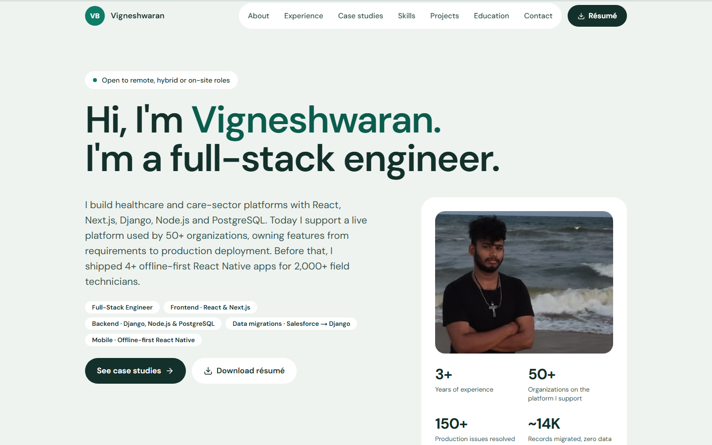
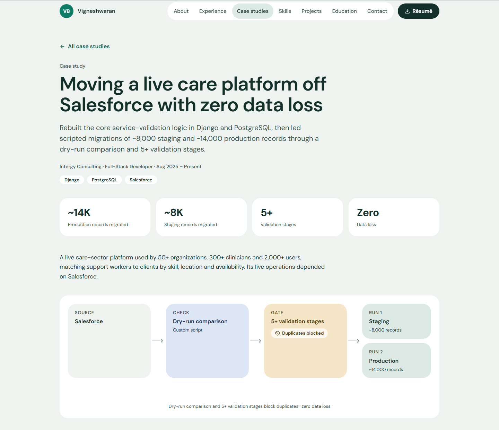
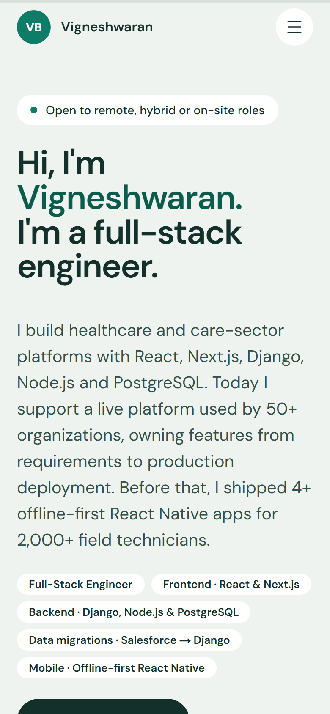
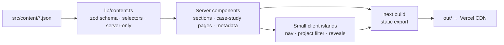

# Vigneshwaran B — Portfolio

[](https://github.com/Bv2124/Portfolio/actions/workflows/ci.yml)

Personal site of a Full-Stack Engineer: **<https://bv2124.vercel.app>**

A statically exported Next.js site whose every fact comes from validated content files, tested
end to end on desktop and mobile, accessible by default, and animated without hiding anything
from crawlers, screen readers or people who prefer reduced motion.

| Home | Case study | Mobile |
|---|---|---|
|  |  |  |

## Highlights

- **Content as data, validated.** All copy lives in `src/content/*.json` and is parsed by a zod
  schema at build time. Types come from the schema, cross-references are checked, and a bad edit
  fails the build with the exact field path.
- **Case studies** at `/case-studies/<slug>/`, each with its own canonical URL, Open Graph card and
  `TechArticle` structured data.
- **Project screenshots.** Each personal project shows its live home page, captured from the real
  URL with `npm run shots:projects` and checked in, so the card is the hook and the image is the link.
- **Design tokens, not raw colours.** The palette is a set of semantic tokens (CSS variables exposed
  to Tailwind by name) and Tailwind's default palette is removed, so a stray `bg-slate-900` can't
  ship. Light theme, one typeface (DM Sans, self-hosted at build time).
- **Motion without the usual costs.** CSS-first animation, View Transitions for the project
  filter, and no animation library. Nothing is hidden in the server HTML; reduced motion and
  no-JS are tested modes.
- **Accessible:**
  - no serious or critical axe violations (WCAG 2.1 A/AA rules) on any page, checked in CI
  - skip link and landmarks
  - focus management in the mobile menu
  - 44px tap targets and contrast-checked colour tokens
- **Quality gates in CI:** lint, strict type-check, unit tests, build, a JavaScript size budget,
  Playwright on desktop and mobile (smoke, accessibility, SEO, motion, security headers), and a Lighthouse budget.

## Results

Measured on the production build (`out/`):

| Metric | Home | Case study |
|---|---|---|
| Lighthouse (desktop): performance / accessibility / best practices / SEO | 98–100 / 100 / 100 / 100 | 99–100 / 100 / 100 / 100 |
| First-load JavaScript | 120 kB | 113 kB |
| LCP, real Chrome, 4× CPU + slow 4G (median of 7, `npm run lcp`) | ≈ 3.6 s | — |
| Unit tests / end-to-end tests | 112 / 207 (desktop, mobile and a Safari smoke run) | |

The LCP figure comes from `npm run lcp` (Pixel 7 profile, 4× CPU slowdown, 1.6 Mbps, 150 ms RTT).
It depends on the machine's CPU, so use it to compare before and after a change on the same
machine, not against a number measured elsewhere. Why real-browser numbers were preferred over
Lighthouse's simulation, and what the redesign did to them, is in
[ADR 3](docs/adr/0003-motion-and-performance-budget.md).

## Architecture



- Pages are **server components**. Only interactive pieces are client components, and none of them
  import the content module. They receive just the fields they render (the navbar gets four
  strings; the project filter gets the project list), so the rest of the JSON never ships to the
  browser.
- Dates that change over time (years of experience, current job duration) render a build-time
  value and correct themselves after load, so there is no hydration mismatch.

### Key decisions

1. [Ship the site as a static export](docs/adr/0001-static-export.md)
2. [Keep content in validated JSON, separate from components](docs/adr/0002-validated-json-content.md)
3. [Motion is CSS-first, never hides content, and has a budget](docs/adr/0003-motion-and-performance-budget.md)
4. [Set security headers in vercel.json, and test them before they ship](docs/adr/0004-security-headers.md)

## Getting started

Requires Node 24 (see `.nvmrc`).

```bash
npm ci
npm run dev                       # http://localhost:3000
npx playwright install chromium webkit   # once, for the end-to-end tests
npm run verify                    # everything CI runs
```

| Command | What it does |
|---|---|
| `npm run dev` | Development server |
| `npm run build` | Static export to `out/` (also lints and type-checks) |
| `npm run preview` | Serve `out/` on http://localhost:4173 |
| `npm run lint` | ESLint, zero warnings allowed |
| `npm run typecheck` | `next typegen` + `tsc --noEmit` (strict) |
| `npm test` | Vitest: date helpers, content schema, résumé-fidelity checks |
| `npm run test:e2e` | Playwright against `out/`: smoke, accessibility (axe), SEO, motion, security headers |
| `npm run budget` | Fail if the home page's first-load JavaScript exceeds 150 kB (gzipped) |
| `npm run verify` | All of the above, in order |
| `npm run og` | Regenerate the link-preview image from the content |
| `npm run screenshots` | Regenerate the screenshots above from the build |
| `npm run shots:projects` | Re-capture each personal project's live home page into `public/projects/` (needs network) |
| `npm run lcp` | Measure LCP of the build under mobile throttling (median of 7 runs) |

## Project structure

```
src/
  app/              routes: layout, home, case-studies/[slug], sitemap, robots, 404
  content/          the content (JSON) and its index
  components/
    layout/         navbar, footer, progress bar
    sections/       home-page sections
    case-study/     case-study page parts and visuals
    motion/         reveal, count-up, play-on-view, timeline
    ui/             headings, rich text, live values
  hooks/            small client hooks
  lib/              schema, content selectors, date helpers, icons, section registry
e2e/                Playwright specs
public/             résumé PDF, portrait, project screenshots, link-preview image
docs/               ADRs, content guide, README screenshots, the redesign brief
scripts/            OG image, screenshot, project-screenshot, size-budget and LCP scripts
```

To change what the site says, see the **[content guide](docs/content.md)**.

`public/google53cb6bda22f1b3ca.html` is the Google Search Console ownership file. Keep it.

## Licence

Source code is MIT (see [LICENSE](LICENSE)). The personal content (`src/content/`) and the résumé
PDF are © Vigneshwaran B and are not licensed for reuse.
